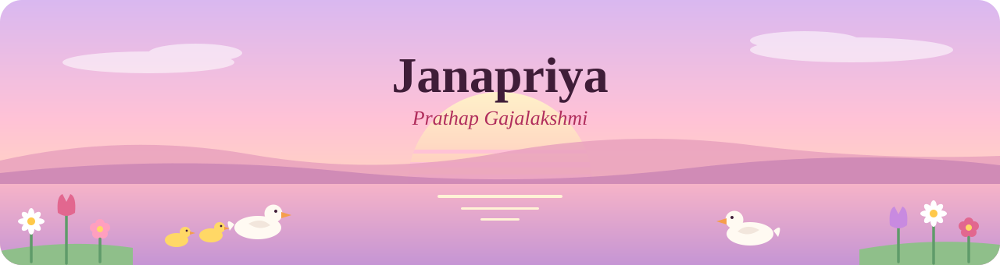

  

  

  
  
  
  

  

> 🌸 **Looking for a 2027 co-op or internship** in **ML / AI, data science, or business analytics**. Let's talk: [janacompsci@gmail.com](mailto:janacompsci@gmail.com)

~~~python
class Janapriya:
    degree   = "BSc Computing Science, AI · University of Alberta (expected 2028)"
    research = ["bandit algorithms × LLMs", "vision transformers for welding video"]
    goal     = "AI for health care"
    builds   = ["LLM apps", "data pipelines", "deployed ML demos", "assistive tools"]
    roles    = {
        "UR2PhD":          "RL Research Assistant",
        "CCWJ, UAlberta":  "Research Assistant",
        "Layer by Layer":  "VP, Design",
    }
    seeking  = "2027 co-op / internship · ML/AI · data science · analytics"
    # also: sunsets, flowers, ducks 🦆
~~~

### ✿ what I'm up to

- 🌸 studying how LLM-provided context can make **bandit algorithms** (ε-greedy, UCB, Thompson sampling) more data-efficient — **UR2PhD**
- 🌷 adapting a **vision transformer with temporal memory** to segment and track droplets in high-speed welding video — **CCWJ**
- 🌺 shipped a skin lesion classifier that **refuses photos unlike its training data**, live on Azure: [try the demo](https://skin-lesion-demo.calmplant-b2760678.northcentralus.azurecontainerapps.io/)
- 🌼 leading design for adaptive tools for people with disabilities — **Layer by Layer**

### ✿ projects

| project | what it does | built with |
|---|---|---|
| 🦆 **[Skin Lesion Classification under Distribution Shift](https://github.com/Janacreates/skin-lesion-shift-peft)** · [**live demo**](https://skin-lesion-demo.calmplant-b2760678.northcentralus.azurecontainerapps.io/) | ViT fine-tuned three ways (linear probe, full, LoRA) and tested on smartphone photos. A shift detector flags unfamiliar images before predicting (AUROC 0.95 across 5 seeds, catching 71% of smartphone photos vs 24% for the model's own confidence) | PyTorch · ViT · PEFT · ONNX (int8) · Docker · GitHub Actions · Azure Container Apps |
| 🦆 **[LAIrner](https://github.com/bhuvanchandar7/LAIrner)** | Agentic AI tutor that gives hints instead of answers, with guardrails against answer leaks and per-student hint density | GPT-4o · Next.js · Prisma · Turso |
| 🦆 **[Student Spend Insights](https://github.com/Janacreates/student-spend-insights)** | End-to-end pipeline on 150K transactions with spend forecasting (~15% better than baseline) and a simulated A/B test | Python · SQLite · scikit-learn · Streamlit · GitHub Actions |

### ✿ skills

| area | tools & skills |
|---|---|
| 🌸 **ML / AI** |       LLMs · prompt engineering · LLM orchestration · fine-tuning · reinforcement learning (bandits) · NLP · computer vision (Vision Transformers) · distribution-shift detection |
| 🌷 **Data science** |      statistics · forecasting · model evaluation · data cleaning & pipelines |
| 🌼 **Business analytics** |       A/B testing (CUPED, power analysis) · forecasting · dashboards · turning data into decisions |
| 🪷 **Engineering & cloud** |                CI/CD · automated testing · containerized deployment · full-stack web apps |
| 🎨 **Graphic design** |    visual & UX design · design for accessibility (VP Design, Layer by Layer) |

  

